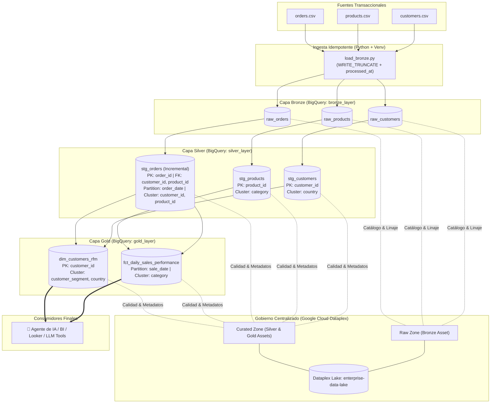
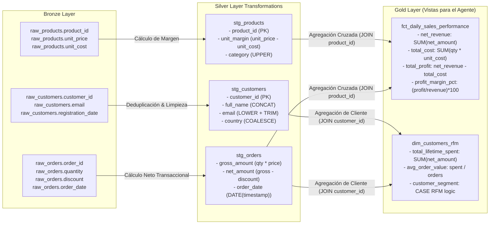

# GCP BigQuery Dataform Medallion Architecture (`gcp-bigquery-dataform-medallion`)

Pipeline integral de ingeniería de datos y gobierno empresarial en **Google Cloud Platform (GCP)** implementando la **Arquitectura Medallion (Bronze, Silver, Gold)** con **BigQuery**, **Dataform (SQLX)**, **Terraform** y **Google Cloud Dataplex**.

Diseñado para proporcionar **linaje de datos bidireccional exhaustivo (a nivel de tabla y columna)**, calidad de datos gobernada mediante aserciones automáticas y agregaciones analíticas listas para ser consumidas por modelos de Machine Learning o **Agentes Autónomos de Inteligencia Artificial**.

---

## 🏛️ 1. Arquitectura de Datos y Linaje

### 1.1 Diagrama de Arquitectura Global (Mermaid)



---

### 1.2 Linaje Detallado a Nivel de Tabla y Columna (Column-Level Lineage)

Este grafo detalla la procedencia de cada columna hasta la capa Gold, garantizando que el Agente de IA pueda explicar el origen y cálculo exacto de cada métrica:



---

## 📁 2. Estructura de Directorios del Repositorio

```text
gcp-bigquery-dataform-medallion/
├── .gitignore                               # Exclusiones de secretos, pycache, .terraform y venv
├── README.md                                # Documentación ejecutiva y técnica del proyecto
├── setup_directories.sh                     # Script Bash para inicializar el árbol de carpetas
│
├── terraform/                               # Infraestructura como Código (IaC)
│   ├── variables.tf.json                    # Variables centralizadas leídas por Terraform y Python
│   ├── main.tf                              # APIs, Datasets BigQuery, Service Account, Repositorio Dataform
│   ├── dataplex.tf                          # Lake, Zonas Raw/Curated y Assets de gobernanza
│   └── outputs.tf                           # Outputs de credenciales, IDs y endpoints
│
├── ingestion/                               # Componente de Ingesta Python
│   ├── requirements.txt                     # Dependencias (pandas, google-cloud-bigquery, pyarrow)
│   ├── load_bronze.py                       # Carga idempotente con WRITE_TRUNCATE y auditoría UTC
│   └── data/                                # Archivos transaccionales origen
│       ├── customers.csv                    # Clientes con duplicados deliberados para probar deduplicación
│       ├── products.csv                     # Catálogo de productos y precios unitarios
│       └── orders.csv                       # Órdenes transaccionales diarias
│
└── dataform/                                # Transformaciones y Modelado ELT (SQLX)
    ├── dataform.json                        # Configuración del compilador de Dataform
    └── definitions/
        ├── bronze/
        │   └── declarations.js              # Declaración formal de fuentes de la capa Bronze
        ├── silver/
        │   ├── stg_customers.sqlx           # Limpieza, deduplicación de clientes y clustering
        │   ├── stg_products.sqlx            # Saneamiento de productos, assertions de margen
        │   └── stg_orders.sqlx              # Modelo incremental, particionado diario y clustering
        └── gold/
            ├── fct_daily_sales_performance.sqlx # Agregación de ventas, márgenes y rentabilidad
            └── dim_customers_rfm.sqlx       # Segmentación RFM y Lifetime Value para Agentes de IA
```

---

## 🛡️ 3. Reglas de Calidad y Gobernanza de Datos (Data Quality)

El proyecto implementa aserciones nativas en Dataform que detienen la propagación de datos corruptos:

| Capa | Tabla | Regla de Calidad / Aserción | Propósito de Negocio |
| :--- | :--- | :--- | :--- |
| **Silver** | `stg_customers` | `uniqueKey: ["customer_id"]` | Garantizar que no existan clientes duplicados tras el `ROW_NUMBER()`. |
| **Silver** | `stg_customers` | `nonNull: ["customer_id", "email"]` | Ningún registro puede carecer de identidad o medio de contacto. |
| **Silver** | `stg_products` | `uniqueKey: ["product_id"]` | Clave primaria estricta de catálogo. |
| **Silver** | `stg_products` | `rowConditions: ["unit_price >= unit_cost"]` | Evita que un producto se registre con precio de venta menor al costo unitario. |
| **Silver** | `stg_orders` | `uniqueKey: ["order_id"]` | Identificador transaccional único. |
| **Silver** | `stg_orders` | `rowConditions: ["quantity > 0", "net_amount >= 0"]` | No permite órdenes con cantidades negativas o montos netos anómalos. |
| **Gold** | `fct_daily_sales_performance` | `uniqueKey: ["sale_date", "product_name"]` | Asegura que la granularidad de la agregación diaria no sufra duplicación de métricas. |
| **Gold** | `dim_customers_rfm` | `uniqueKey: ["customer_id"]` | Garantiza una única fila consolidada por cada cliente. |

---

## 🚀 4. Guía de Instalación Paso a Paso

### Prerrequisitos
* Cuenta activa en Google Cloud Platform con facturación habilitada.
* Google Cloud SDK (`gcloud` CLI) instalado y autenticado:
  ```bash
  gcloud auth login
  gcloud auth application-default login
  ```
* Terraform `>= 1.5.0` instalado.
* Python `>= 3.10` instalado.

---

### Paso 1: Clonar y Configurar Variables de Terraform
1. Clona el repositorio y entra al directorio:
   ```bash
   git clone https://github.com/tu-usuario/gcp-bigquery-dataform-medallion.git
   cd gcp-bigquery-dataform-medallion
   ```
2. Edita `terraform/variables.tf.json` con tu `project_id` real de GCP:
   ```json
   {
     "variable": {
       "project_id": {
         "default": "MI_PROYECTO_GCP_REAL"
       },
       "region": {
         "default": "us-central1"
       }
     }
   }
   ```
3. Edita `dataform/dataform.json` para que `defaultDatabase` coincida con tu `MI_PROYECTO_GCP_REAL`:
   ```json
   {
     "defaultDatabase": "MI_PROYECTO_GCP_REAL",
     "defaultLocation": "us-central1"
   }
   ```

---

### Paso 2: Desplegar Infraestructura y Dataplex con Terraform
```bash
cd terraform
terraform init
terraform validate
terraform plan
terraform apply -auto-approve
```
* **Resultado:** Terraform creará los 3 datasets en BigQuery (`bronze_layer`, `silver_layer`, `gold_layer`), la Service Account, el Data Lake en Dataplex con sus 2 zonas y 3 assets mapeados, y exportará automáticamente la clave `pipeline-service-account-key.json`.
```bash
cd ..
```

---

### Paso 3: Ingesta a Capa Bronze con Entorno Virtual en Python
```bash
cd ingestion

# 1. Crear entorno virtual aislado
python -m venv venv

# 2. Activar el entorno virtual
# En Linux/macOS:
source venv/bin/activate
# En Windows (Git Bash o CMD):
# source venv/Scripts/activate  O  venv\Scripts\activate

# 3. Instalar librerías requeridas
pip install --upgrade pip
pip install -r requirements.txt

# 4. Ejecutar la ingesta
python load_bronze.py

# 5. Desactivar el entorno al finalizar
deactivate
cd ..
```
* **Resultado:** Las tablas `raw_customers`, `raw_products` y `raw_orders` quedan cargadas en `bronze_layer` con su columna de auditoría `processed_at`.

---

### Paso 4: Ejecutar Transformaciones y Calidad en Dataform
Puedes ejecutar Dataform directamente desde la consola web de Google Cloud o mediante el CLI:

#### Opción A: Desde la Consola de BigQuery Studio (Creación de Workspace)
1. Ve a **Google Cloud Console** $\rightarrow$ **BigQuery** $\rightarrow$ **Dataform**.
2. Selecciona la región (ej. `us-central1`) y haz clic sobre el repositorio aprovisionado: **`medallion-dataform-repo`**.
3. En la pestaña **Development Workspaces** (Espacios de trabajo de desarrollo), haz clic en el botón superior **+ Create development workspace** (o **Crear espacio de trabajo de desarrollo**).
4. En el panel lateral derecho:
   * **Workspace ID**: Escribe `dev-workspace` (o el identificador de tu preferencia).
   * Haz clic en **Create**.
5. Ingresa al workspace haciendo clic sobre su nombre (`dev-workspace`).
6. Carga o sincroniza los archivos de la carpeta `dataform/`:
   * Si vinculaste el repositorio a GitHub, haz clic en **Pull from default branch**.
   * Si estás trabajando directamente en consola, sube o crea el archivo `dataform.json` en la raíz y la carpeta `definitions/` con sus modelos (`bronze/`, `silver/`, `gold/`), sino hacerla de forma manual creando directorios y los archivos.
7. Verifica que en la esquina superior derecha aparezca el indicador en verde **Compiled successfully**.
8. Haz clic en **Start Execution** $\rightarrow$ selecciona **All actions** (o marca la opción de incluir dependencias).

#### Opción B: Mediante Dataform CLI Local
```bash
cd dataform
npm install -g @dataform/cli
dataform compile
dataform run
cd ..
```
* **Resultado:** Se materializan las tablas en `silver_layer` y `gold_layer`, ejecutándose todas las aserciones de calidad.

---

## 🤖 5. Consumo por el Agente de Inteligencia Artificial

El Agente de IA (desarrollado con LangChain, LlamaIndex o Vertex AI Agent Builder) tiene como punto de entrada exclusivo la **Capa Gold**:

```sql
-- Vista analítica 360 para responder consultas estratégicas:
SELECT
  c.full_name,
  c.customer_segment,
  c.total_lifetime_spent,
  c.avg_order_value,
  s.product_name,
  s.net_revenue,
  s.profit_margin_pct
FROM
  `MI_PROYECTO_GCP_REAL.gold_layer.dim_customers_rfm` c
JOIN
  `MI_PROYECTO_GCP_REAL.gold_layer.fct_daily_sales_performance` s
  ON c.country = 'PE';
```

Gracias a los metadatos integrados en Dataplex y las descripciones a nivel de columna en Dataform, el Agente puede leer el catálogo semántico y explicarle al usuario de negocio cómo se computó cada indicador.

---

## 🧹 6. Guía de Desinstalación (Clean Up)

Para eliminar todos los recursos y evitar costos residuales en GCP:

```bash
cd terraform

# Destruye los Data Lakes, repositorios Dataform, asignaciones IAM y Datasets
terraform destroy -auto-approve

# Eliminar clave local privada generada
rm -f pipeline-service-account-key.json

cd ..
```
